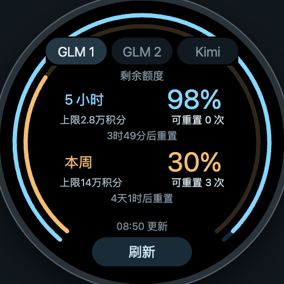

# AI Quota Watch

把 GLM 和 Kimi Code 的套餐余量放到华为手表上：冰蓝看五小时，琥珀看本周。

使用 Lite Wearable 原生 JS / HML / CSS，打开应用即可查询，不需要电脑或自建服务持续在线。当前提供 GLM 1、GLM 2、Kimi 三个固定账号入口；GLM 额外显示额度上限、可用重置次数和重置时间。每个账号独立缓存，查询失败保留上次结果并标记过期。不显示月额度。

<p align="center">
  
</p>

> 图片来自浏览器预览，额度随实际账号变化。它是需要打开的手表应用。实时额度表盘另在试验中，尚未验证 GT 6 的第三方数据更新通道。

## 你需要准备什么

| 项目 | 要求 |
| --- | --- |
| 手表 | **已验证：国行 HUAWEI WATCH GT 6，466×466，HarmonyOS 7.0.0.107**。其他 GT / FIT / D 设备需要单独验证，不能直接套用全智能 WATCH 的安装教程。 |
| 手机 | **本教程需要华为手机**，安装华为运动健康和应用调测助手，并与手表完成蓝牙配对。已验证 Mate 30 / HarmonyOS 4.2；其他手机、系统和区域取决于助手可用性。iPhone 的开发 HAP 导入路径未验证。 |
| 电脑与线缆 | 能运行配套华为 SDK 的电脑、一条支持数据传输的 USB 线。本文命令以 macOS / Linux shell 为例，实际完整流程在 macOS 验证。 |
| 开发工具 | Node.js 24+、Python 3、DevEco Studio 26 或匹配的 Command Line Tools / SDK 26.0.0、配套 Java、Android Platform Tools（`adb`）。 |
| 华为账号 | 可访问开发者中心的账号，建议先完成实名认证；首次调试需要自己的证书、Profile 和**手表 UDID**。 |
| 额度账号 | 国内 GLM Coding Plan 或 Kimi Code 的 API Key。至少配置一个；普通平台钱包余额不等于 Coding 套餐额度。 |

官方 Lite 安装流程依赖手机上的运动健康与应用调测助手，并使用手动签名。[官方安装指南](https://developer.huawei.com/consumer/cn/doc/harmonyos-guides-V2/run_fitnesswatch-0000001054134240-V2/)

## 交给 AI 帮你部署（★推荐）

把仓库交给具备**终端、浏览器操作、Android 真机操作**能力的 AI 编程助手，并发送下面这段话。纯聊天助手无法替你完成安装；登录、实名认证、验证码、手机 USB 授权仍需要本人配合。

```text
请先阅读 AGENTS.md、README.md 和 docs/SETUP.md，帮我把这个项目部署到自己的华为手表。

请检查电脑工具、华为手机、运动健康与应用调测助手、手表配对状态。
我授权你为这次自用调试创建所需的应用记录、调试证书和 Profile，
构建并签名 HAP，传到我的华为手机，再通过应用调测助手安装到配对手表。
保留我已有的其他应用、证书和设备登记；不要吊销或删除它们。
新账号首次创建应用时，先与我确认应用包名；已有部署则沿用匹配的包名和签名。

需要我操作时，请明确给出当前页面和下一步：例如登录、实名认证、扫码、
验证码、USB 调试授权、选择上传文件。我会把 API Key 保存在本机 .secrets/，
不要把 Key、私钥或密码输出到聊天、截图、日志或仓库。

先运行测试和本地预览，再进行正式 SDK 构建、Profile 校验、Lite JS 检查、
签名、传包和手表安装验证。传包成功不等于安装成功；请核对助手安装日志，
并确认手表中的 AI 用量应用能打开、切换已配置账号、完成刷新。
没有浏览器或手机控制工具时，请继续完成本机部分，并给我精确的手动步骤。
```

[AGENTS.md](AGENTS.md) 是 AI 的执行约定；[完整部署指南](docs/SETUP.md) 包含浏览器逐页操作、CSR/证书/Profile 申请、USB 调试、安装和排错。不需要把作者的证书或设备信息交给 AI。

## 先在电脑上运行

克隆你的仓库后，在项目根目录执行；运行和测试不需要安装 npm 依赖。

```sh
git clone https://github.com/Ithrael/ai-quota-watch.git
cd ai-quota-watch
npm test
mkdir -p .secrets
```

用本地编辑器把自己的 Key 写入下列文件，不要把真实值放入公开命令、截图或提交中：

| 账号 | 本机文件 | 可替代的环境变量 |
| --- | --- | --- |
| GLM 1 | `.secrets/glm-api-key` | `GLM_API_KEY` |
| GLM 2 | `.secrets/glm-api-key-2` | `GLM_API_KEY_2` |
| Kimi Code | `.secrets/kimi-api-key` | `KIMI_API_KEY` |

只配置需要的账号即可；未配置的账号入口会显示配置提示。Kimi 应从 [Kimi Code 控制台](https://www.kimi.com/code/console) 创建有套餐查询权限的 Key。

```sh
chmod 700 .secrets
# 对已创建的 Key 文件设置 chmod 600，再运行：
npm run preview
```

打开 <http://127.0.0.1:4173>，切换账号并查看额度。服务只监听本机；真实 Key 留在本机服务端，不发送给浏览器。浏览器预览不是华为模拟器，无法替代手表验证。`npm run check:glm` 可以单独验证第一个 GLM 账号的只读查询。

## 从源码到手表

首次先完成[证书和手机准备](docs/SETUP.md)，已有材料可直接执行：

```sh
# 按实际安装位置填写，不要照抄他人电脑的路径。
export HUAWEI_SDK_ROOT="/absolute/path/to/command-line-tools"
export HVIGORW="$HUAWEI_SDK_ROOT/bin/hvigorw"
# 如系统 Java 不是配套版本，再设置 JAVA_HOME。

npm run build:watch
npm run sign:watch
npm run push:phone
```

- `build:watch`：生成本机账号配置，调用官方 Hvigor，先 clean 再构建 Lite BIN / HAP。
- `sign:watch`：读取本机签名配置，使用官方工具校验 Profile、用 SDK JerryScript 检查编译后的 JS，再签名 Lite BIN 并打包 HAP。
- `push:phone`：把已签名 HAP 复制到手机 `/sdcard/haps/ai-quota-watch.hap`，请求打开应用调测助手。多手机连接时设置 `ANDROID_SERIAL`。

随后在助手的“应用管理”中选择该 HAP 安装，查看安装日志，再打开手表应用验证。AI 有真机控制工具时可以继续完成这些操作。**安装目标是手表；手机承担配对、传包和网络代理，本项目不生成手机 APK。**

输出文件：`entry/build/default/outputs/default/entry-default-signed.hap`。

## 证书和浏览器操作速览

1. 在本机生成自己的 `.p12` 和 `.csr`，保留私钥及密码。
2. 本人在浏览器登录[华为开发者联盟](https://developer.huawei.com/consumer/cn/)，完成账号认证；AI 可以继续操作已登录的页面。
3. 为自己的 Lite 应用创建应用记录，包名与 `entry/src/main/config.json` 一致。
4. 进入“开发者管理 → ID、证书和Profile”，上传 **CSR** 申请调试证书，下载 `.cer`；登记**手表 UDID**；为该应用选择证书和手表，申请调试 Profile，下载 `.p7b`。
5. 将材料放入 `.secrets/watch-signing/`，按 [config/signing.example.json](config/signing.example.json) 创建本机 `config.json`，然后构建、签名和安装。

菜单名称可能随控制台更新；[完整指南](docs/SETUP.md) 逐项列出了字段、文件命名和核对方法。**CSR 可以上传给华为申请证书，P12、私钥、密码和 API Key 留在本机。** 开发者证书与主题表盘设计师权限是两套流程，本应用安装不需要主题设计师权限。

## 开源与凭据

开源的是源代码和无凭据的示例配置。`.secrets/`、`.local/`、生成的 `common/local-config.js`、构建目录、HAP、私钥及证书材料已排除出 Git。

**自用调试 HAP 会包含配置进去的 API Key。** `.gitignore` 不会加密安装包；不要把自己构建的 HAP 上传到 Releases、网盘公开链接或仓库。其他使用者应配置自己的 Key，申请绑定自己手表的 Profile，并自行构建。截图和日志也应去掉账号、设备标识和敏感字段。

发布前核对 `git status` 与待提交文件；仓库中不应出现真实 Key、密码、UDID、个人绝对路径或签名材料。忽略规则不能清理已经提交到历史中的秘密。

许可证待维护者确认，当前尚未提供 `LICENSE`。

## 开发说明

- `src/glm.js`、`src/kimi.js`：无凭据的共享解析器。
- `entry/src/main/js/MainAbility/pages/index/`：手表页面。
- `scripts/prepare-watch.mjs`：生成已忽略的本机配置和共享解析器副本。
- `scripts/sign-watch.py`、`scripts/push-phone.mjs`：公开、可复用的签名与传包脚本。
- `preview/`：复用实际页面逻辑的浏览器预览；`tests/`：额度解析、缓存、账号隔离和刷新流程测试。

Lite JerryScript 不支持本项目常见桌面代码里的正则和 `String.replace`；手表逻辑使用 `split/join` 等已验证能力。`entry/package.json` 的 CommonJS 设置、短资源引用、图标及 SDK 兼容版本均与真机构建有关，修改前阅读 [AI 执行约定](AGENTS.md)。

当前仅在打开应用或点击刷新时查询，普通 Lite 应用没有已实现的后台轮询或常显表盘能力。手表通过配对手机的运动健康代理联网；退出电脑预览服务不影响已安装应用。接口只读，不调用模型，也不兑换重置机会。

## 参考资料

- [华为 Lite Wearable 开发指南](https://developer.huawei.com/consumer/cn/doc/lite-wearable-guides/lite-wearable-bpta-guide/)
- [华为 Lite 安装指南](https://developer.huawei.com/consumer/cn/doc/harmonyos-guides-V2/run_fitnesswatch-0000001054134240-V2/)
- [申请调试证书](https://developer.huawei.com/consumer/cn/doc/app/agc-help-add-debugcert-0000001914263178/) · [注册调试设备](https://developer.huawei.com/consumer/cn/doc/app/agc-help-add-device-0000002283189937/) · [申请调试 Profile](https://developer.huawei.com/consumer/cn/doc/App/agc-help-add-debugprofile-0000001914423102/)
- [下载华为 Command Line Tools](https://developer.huawei.com/consumer/cn/download/command-line-tools-for-hmos)
- [智谱官方用量查询实现](https://github.com/zai-org/zai-coding-plugins/blob/main/plugins/glm-plan-usage/skills/usage-query-skill/scripts/query-usage.mjs)
- [Kimi Code 官方额度解析实现](https://github.com/MoonshotAI/kimi-code/blob/main/packages/oauth/src/managed-usage.ts)

本项目由社区维护，与华为、智谱、Moonshot AI 无隶属关系。查询接口和平台套餐规则可能变化。
